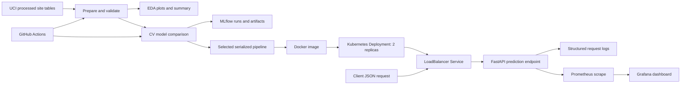

# End-to-End MLOps for UCI Heart Disease Classification

**Course:** Machine Learning Operations (MLOps), AIMLCZG523  
**Assignment:** Assignment 01  
**Student:** _Add name and ID_  
**Date:** 6 October 2026  
**Repository:** _Add GitHub URL after publishing_

> Educational classification exercise only. The system is not validated for clinical decision-making, triage, or patient care.

## Executive summary

This project builds a reproducible path from the supplied UCI heart disease files to an API packaged for Docker and Kubernetes. It combines the four supplied processed tables, translates the original ordinal diagnosis into an explicit binary endpoint, imputes missing predictors within a fitted pipeline, compares Logistic Regression and Random Forest, records experiment metadata in MLflow, and exposes prediction, readiness, and monitoring endpoints. CI runs static checks, data preparation, tests, EDA, and training. The deployment configuration uses two API replicas behind a LoadBalancer Service. The combined cleaned table contains 920 labeled rows (411 absence; 509 presence). On the stratified holdout, Logistic Regression reached 83.7% accuracy and 86.3% recall; Random Forest reached 85.9% accuracy and 90.2% recall. Random Forest was selected by cross-validation recall.

The scope is a course demonstration, not a clinically validated product. The dataset is small, historical, geographically mixed, selected from patients undergoing diagnosis, and contains uneven missingness and site differences. Results are descriptive of this benchmark and should not be interpreted as evidence of clinical utility.

## 1. Problem framing and source data

The prediction target is whether the historical angiographic diagnosis indicates presence of heart disease. In the original data, `num=0` denotes absence and values 1 through 4 denote presence. This project uses `target = 1` for any value greater than zero. The 13 predictors are age, sex, chest pain type, resting blood pressure, cholesterol, fasting blood sugar indicator, resting ECG, maximum heart rate, exercise-induced angina, ST depression, ST slope, number of major vessels, and thalassemia category.

The supplied directory includes processed files for Cleveland, Hungary, Switzerland, and VA Long Beach. We use these four sources to exercise missing-data handling and multisite heterogeneity, preserving a `site` field for EDA and audit. The site field is excluded from training to avoid a shortcut based on collection site. Source metadata and the original attribute notes are in `heart+disease/heart-disease.names`. Acquisition and preparation are repeatable with `scripts/prepare_data.py`; the project cites the [UCI Heart Disease dataset](https://archive.ics.uci.edu/dataset/45/heart%2Bdisease) (DOI 10.24432/C52P4X).

| Site | Source table | Raw records noted by UCI |
|---|---|---:|
| Cleveland | processed.cleveland.data | 303 |
| Hungary | processed.hungarian.data | 294 |
| Switzerland | processed.switzerland.data | 123 |
| VA Long Beach | processed.va.data | 200 |

Missing question marks and `-9` sentinels are parsed as missing numeric values. Rows with missing target are removed because supervised labels cannot be imputed responsibly. Missing predictors remain in the delivered combined table and are filled only inside the training folds, preventing information from validation partitions from influencing imputation. No source files are overwritten.

## 2. Exploratory analysis

The EDA script writes a feature histogram panel, a numeric-coded correlation heatmap, a class balance plot, and a machine-readable summary under `artifacts/eda/`. The summary includes row and class counts, per-feature missingness, and site counts. The heatmap is a descriptive Pearson correlation over numeric-coded categories; it is not a claim that category codes are interval-scaled. Category distributions should be interpreted alongside the UCI attribute definitions.

The class balance chart informs use of stratified splitting and reporting precision, recall, and ROC-AUC in addition to accuracy. Site counts and missingness matter because pooled random splitting may put examples from each site in both training and test sets. `ca` is missing in 611/920 rows and `thal` in 486/920; these high rates may weaken those signals despite imputation. This measures interpolation within the pooled cohort and can overstate transportability to a new hospital. A stronger follow-up would hold out one entire site and report its performance separately.

**Insert final EDA figures here:** `artifacts/eda/feature_histograms.png`, `correlation_heatmap.png`, and `class_balance.png`.

## 3. Feature engineering and model development

The reusable sklearn pipeline separates continuous measurements from nominal or ordinal-coded categories. Numeric columns use training-fold median imputation and standard scaling. Categorical columns use training-fold most-frequent imputation and one-hot encoding with unknown categories ignored. The whole transformer and classifier are fitted together so training and serving share exactly the same operations.

Two candidates are evaluated: class-weighted Logistic Regression (maximum 2,000 iterations) and class-weighted Random Forest (300 trees, minimum leaf size two). The fixed random seed is 42. The data is partitioned into a stratified 80% development set and 20% holdout test set. Five-fold stratified cross-validation is performed only on the development set. Mean CV accuracy, precision, recall, and ROC-AUC are logged. The primary selection criterion is mean CV recall, with mean CV ROC-AUC as tie-breaker, reflecting the assignment's health-screening framing where missed positive labels warrant attention. This choice is not a clinical threshold optimization.

The untouched holdout is reported once for each candidate with accuracy, precision, recall, and ROC-AUC. Threshold is fixed at 0.5. No threshold tuning or hyperparameter search against the holdout is performed. The candidate comparison and selected-model record are stored in `artifacts/training_summary.json`; per-model ROC curves and classification reports are logged as artifacts.

| Model | Mean CV accuracy | Mean CV precision | Mean CV recall | Mean CV ROC-AUC | Holdout accuracy | Holdout precision | Holdout recall | Holdout ROC-AUC |
|---|---:|---:|---:|---:|---:|---:|---:|---:|
| Logistic Regression | 0.8003 | 0.8328 | 0.8058 | 0.8847 | 0.8370 | 0.8462 | 0.8627 | 0.9084 |
| Random Forest | 0.7990 | 0.8156 | 0.8303 | 0.8837 | 0.8587 | 0.8519 | 0.9020 | 0.9247 |

## 4. Experiment tracking and packaging

Each model candidate is its own MLflow run in the `uci-heart-disease-four-site` experiment. Runs log model identity, feature count, seed, holdout fraction, CV fold count, fold-mean metrics, holdout metrics, the ROC image, the classification report JSON, and the fitted sklearn pipeline. Local experiments use MLflow's `mlruns/` file store and the UI can be opened with `mlflow ui --backend-store-uri ./mlruns`.

After comparison, the selected fitted pipeline is serialized to `artifacts/heart_disease_model.joblib`. Since serialization of Python estimators is version-sensitive and untrusted pickle/joblib files can execute code when loaded, only load project-generated artifacts from trusted sources and use the pinned requirements file. The pipeline includes imputers, encoder, scaler, and classifier so inference does not repeat or approximate preprocessing.

## 5. CI and automated tests

`.github/workflows/ci.yml` runs on pushes, pull requests, and manual dispatch. It checks out code, uses Python 3.11, installs pinned packages, runs Ruff, rebuilds the prepared CSV and EDA artifacts, runs the test suite, trains candidates, and uploads artifacts even if a later step fails. A failed lint, test, or training command fails the job, making errors visible in workflow logs.

Tests cover cleaned schema and binary target validity, source coverage and retained missingness, fitting both candidate pipelines with missing input values, probability output finiteness, successful API predictions, confidence semantics, and strict rejection of unexpected request fields. Local commands are `ruff check src scripts tests` and `pytest -q`.

**CI evidence status:** Local tests and lint were executed successfully. Capture the GitHub Actions run after publishing this workflow from the student's own repository.

## 6. Container and API interface

The FastAPI service exposes `POST /predict`, `GET /health`, `GET /metrics`, and generated interactive API docs at `/docs`. The request model requires all 13 feature values and rejects unknown fields. Prediction responses include the binary class, a readable label, predicted-class confidence, positive-class probability, and the decision threshold. Missing model artifacts lead to an explicit unhealthy readiness response and prediction requests return HTTP 503.

The container installs pinned Python dependencies and serves the serialized preprocessing-plus-model pipeline on port 8000. A Docker health check calls `/health`. The sample request in the README exercises the response path. Use `docker compose up --build` for local service startup; `docker compose down` stops it. API access logs record method, route, status, and duration, without logging submitted patient feature values.

## 7. Deployment architecture

`deploy/kubernetes/deployment.yaml` defines two replicas, resource requests and limits, HTTP readiness/liveness checks, and a LoadBalancer Service on port 80. The manifest references `heart-disease-api:local`, suitable for a local Docker Desktop or Minikube workflow after building and loading the image. A public cloud LoadBalancer needs a configured cluster account and provider. `deploy/monitoring-compose.yaml` runs API, Prometheus, and Grafana locally; the sample dashboard displays request count and model availability.

**Deployment evidence:** add screenshots from a successful local cluster showing ready pods, service endpoint, a successful `/predict` response, and the monitoring dashboard. An authored manifest alone does not prove deployment.

## 8. Monitoring, logging, and operational considerations

Every HTTP request emits structured method/path/status/duration log fields. Prometheus scrapes a lightweight process-level request counter and model-loaded gauge at `/metrics`; Grafana provides a sample dashboard. This minimal demonstration has no persistent metrics store configuration, latency histogram, alert rules, authentication, rate limiting, or multi-process aggregation. For production, add ingress TLS, authentication, bounded-cardinality route labels, request/latency/error metrics, durable monitoring, alerting, model version metadata, drift and data quality checks, and audit controls appropriate for sensitive health data.

## 9. Reproducibility and setup

On Windows PowerShell, create and activate a virtual environment, install `requirements.txt`, run `python scripts/prepare_data.py`, then `python scripts/eda.py` and `python -m heart_mLOps.train`. On other operating systems the equivalent Python virtual environment activation command differs; all scripts use relative paths from the repository root. CI independently repeats preparation and training on a clean runner. Exact top-level package versions are pinned. The Docker image installs these requirements and copies the model artifact created by training.

## 10. Limitations, ethics, and next steps

This dataset dates to the 1980s and is not representative of present-day populations or practice. Its labels arise from a historical diagnostic definition. Pooling sites introduces cohort and measurement variation; random cross-validation is not a site-independent test. Missing data are substantial in some tables; median/mode imputation may distort patterns and should not be treated as clinically adequate. Sex, age, and other variables raise fairness questions that this assignment does not resolve. Reported probabilities are not calibrated risk estimates. The model must not be used to diagnose or make care decisions.

Next steps for a rigorous study would validate on a prospectively collected external cohort, pre-register the intended use and operating point, assess subgroup performance and calibration, involve clinical and ethics reviewers, and build privacy, access, reliability, and monitoring controls before any deployment beyond a classroom demonstration.

## Submission evidence and references

**Repository URL:** _Add after pushing the project to your own GitHub account._  
**Deployed URL or local access instructions:** _Add the endpoint and deployment evidence after successful deployment._  
**Video:** _Record and link the short pipeline walkthrough._

### References

1. UCI Machine Learning Repository, [Heart Disease](https://archive.ics.uci.edu/dataset/45/heart%2Bdisease), DOI [10.24432/C52P4X](https://doi.org/10.24432/C52P4X).
2. UCI Heart Disease supplied `heart-disease.names` attribute documentation and site records.
3. Institutional investigators listed by the UCI source documentation: Andras Janosi, William Steinbrunn, Matthias Pfisterer, and Robert Detrano. The historical source requests acknowledgement in publications using these data.
